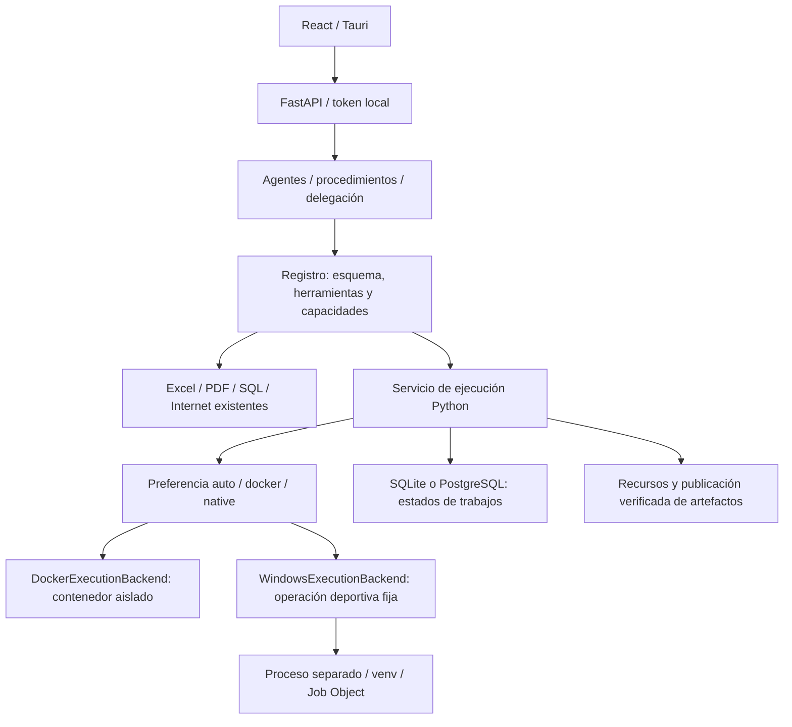

# Arquitectura dual de Oficina IA

## Auditoría del proyecto real

El frontend es React 19/TypeScript/Vite. La ventana de escritorio ya es Tauri 2, implementada en `src-tauri/src/main.rs`; no se introduce Electron. El backend es FastAPI/Python con SQLAlchemy, SQLite local o PostgreSQL configurado. El motor de agentes conserva su cola, procedimientos, delegación y pausas por aprobación. El registro valida herramientas asignadas, JSON Schema y capacidades; las rutas se validan contra recursos asignados y rechazan escapes, enlaces y junctions. Las credenciales continúan en Windows Credential Manager.

El lanzamiento de desarrollo sigue siendo `npm.cmd run dev:local`. Tauri arranca el lanzador Python oculto y termina su árbol al cerrar. El Tauri actual depende del checkout y `.venv`; todavía no constituye una distribución portable. Docker Compose ofrece PostgreSQL/Redis y una imagen de análisis; el perfil container-api no recibe un socket Docker.

## Implementación común

La interfaz `ExecutionBackend.execute` mantiene un único sistema de agentes y herramientas. `execution/service.py` coordina selección, concurrencia, eventos de cancelación y registro persistente; el registro existente conserva esquemas, permisos, auditoría y resultados completos. Los jobs se guardan como entradas `execution_job:<UUID>` en la tabla Settings existente, sin migraciones destructivas. Los interrumpidos se marcan al reiniciar; nunca se reejecutan automáticamente.

Selección: `auto` usa Windows para las operaciones fijas cuando existe el trabajador gestionado y el SO es Windows; de lo contrario intenta Docker. Python arbitrario siempre usa Docker. `docker` exige Docker y la imagen local. `native` acepta `python.execute` con operation/parameters, pero bloquea code/resources y las herramientas `custom.python`, aunque el agente sea trusted. Un fallo del Job Object bloquea la ejecución nativa. Auto no degrada Python arbitrario a una ejecución de usuario.

## Contrato único de python.execute

La auditoría encontró que el servicio dual ya existía, pero python.execute sólo tenía el contrato code/resources y su selección siempre requería Docker. Se extendió su esquema con alternativas estrictas: código libre (compatibilidad) o una operación fija con parámetros; no pueden mezclarse. La herramienta conserva nombre, UUID de registro y capacidad python.execute. Las asignaciones/modelos de agentes no se modifican. SQL, web, Excel y PDF siguen usando sus herramientas existentes.

Catálogo fijo: `statistics.mean`, `sports.group`, `csv.read`, `csv.create`. El worker revisado no recibe código ni credenciales. El backend valida recursos y prepara entradas autorizadas; el worker calcula/genera el contenido, y el backend publica el CSV con integridad y aprobaciones existentes. Tanto Windows como Docker usan la misma implementación de esas operaciones. `sports.analyze` permanece compatible con configuraciones anteriores, pero no es necesario asignarla para usar python.execute.

Cada resultado incluye backend, job_id y duration_ms. Los trabajos persisten operación específica y duración; la interfaz los muestra. Execution y AuditEvent mantienen los argumentos y resultados redacted. Una aprobación de sobrescritura deja el trabajo waiting_approval, sin publicar el archivo hasta la decisión humana.

La preferencia afecta estas operaciones Python. Excel, PDF, SQL e Internet siguen utilizando sus implementaciones existentes y sus propios permisos; no se duplican ni se convierten en scripts.

## Estado de las fases

Auditoría, abstracción, conservación de Docker, operación nativa fija, preferencia persistente, interfaz y documentación implementadas. Preparación de distribución: entrada de backend y receta PyInstaller, separación optativa AppData. Instalador ejecutable: pendiente por herramientas de compilación ausentes y trabajo de integración del sidecar/runtime descrito en EMPAQUETADO_WINDOWS.md. La instalación del modo nativo no requiere Docker.
