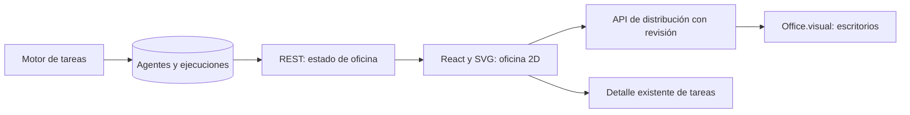

# Oficina 2D

## Arquitectura previa al desarrollo

La oficina 2D es otra vista de los agentes existentes. El organigrama, las asignaciones, los procedimientos, las aprobaciones y el motor de ejecución conservan su funcionamiento.

React dibuja una sala con escritorios y personajes SVG locales. Los personajes trabajan o esperan según el estado persistido del agente; un error y una aprobación tienen indicadores propios. Seleccionar una persona muestra su actividad y permite abrir el detalle real de la tarea.

La vista obtiene un snapshot REST autenticado y se suscribe a `/ws/offices/{id}`. El primer mensaje autentica el token de sesión; el servidor comprueba el origen, envía cambios y heartbeats. El cliente reconecta automáticamente y usa REST como respaldo. Sin una fuente disponible pausa las animaciones. El WebSocket existente de detalle de tareas sigue disponible.

La distribución se guarda en `Office.visual.floorplan`, separada de `Agent.position`, que pertenece al organigrama. La API valida agentes de la oficina, coordenadas y revisión; rechaza una edición antigua para evitar sobrescribir cambios de otro cliente. Cambiar escritorios no modifica permisos ni interrumpe tareas.

La distribución admite arrastre con mouse/táctil, flechas con foco y coordenadas X/Y. Cambiar escritorios requiere guardar o cancelar. El editor conserva su revisión inicial incluso si recibe nuevas actualizaciones, evitando sobrescribir otro plano.

Las visitas entre escritorios representan mensajes reales de delegación y respuesta. El snapshot expone únicamente identificadores, origen, destino y tarea; el contenido sigue en el detalle autenticado de tareas. Un recorrido de cuadrícula evita mesas y paredes, visita el puesto destinatario y vuelve al origen. No se reproducen mensajes históricos al abrir la sala. Si no existe una ruta libre, el personaje permanece en su puesto. Editar el plano cancela el recorrido visual. Los cambios de preferencia de movimiento reducido detienen la caminata.

Componentes: `OfficeScene` integra sala y selección; `OfficeWalker` anima cada personaje; `officePaths` calcula rutas y límites; `useOfficeStream` administra snapshot, WebSocket y recuperación; `useOllamaStatus` distingue servicio accesible de agentes con modelo instalado. El motor existente es la única fuente de trabajo.

Los tres pendientes de la entrega anterior están implementados: arrastre directo, recorridos entre escritorios y WebSocket por oficina.

Verificación: autorización de REST/WebSocket, actualización de estados/plano, revisión concurrente, persistencia, remapeo de agentes al duplicar, rutas libres/bloqueadas, indicador Ollama y regresión del motor. Navegador real: arrastre, teclado, recarga, WebSocket y respaldo REST. La prueba visual de caminata usa un mensaje exclusivo del navegador de prueba; no agrega tareas ni mensajes ficticios a producción. La delegación del motor se prueba por separado con un adaptador explícito de tests.
